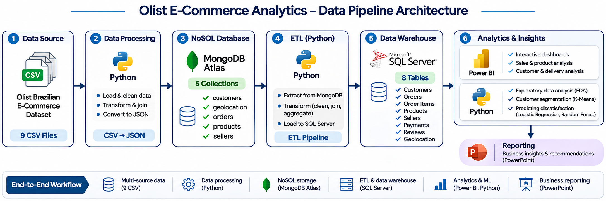
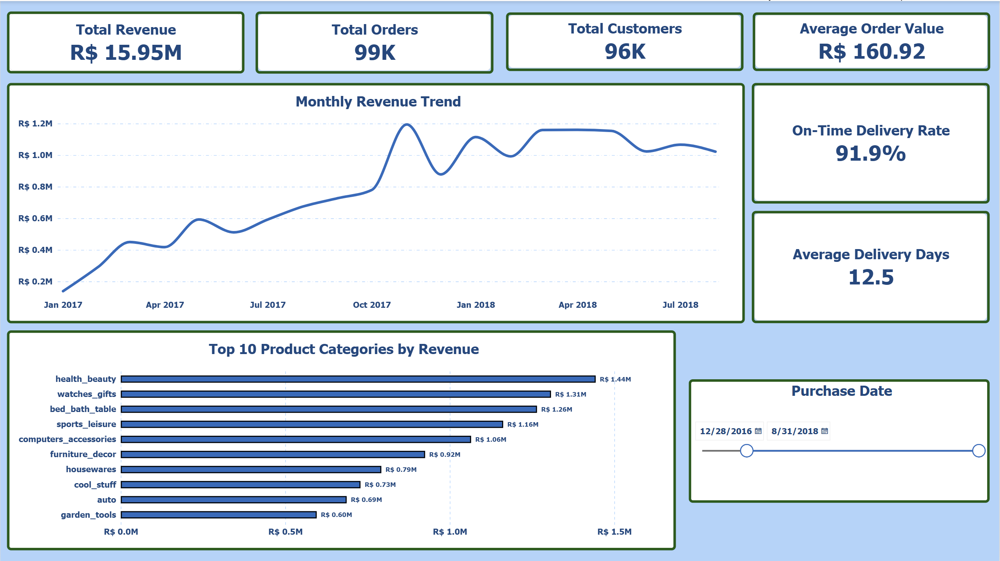
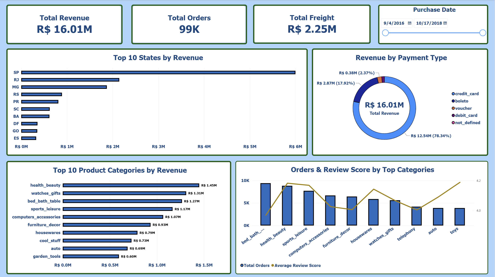
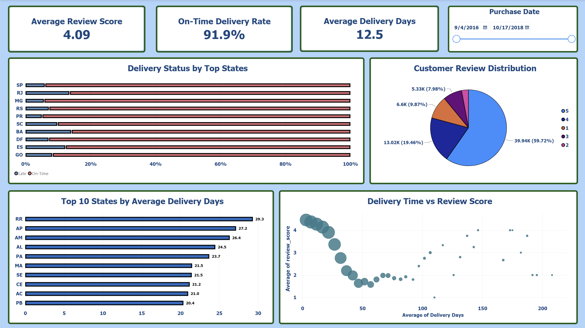
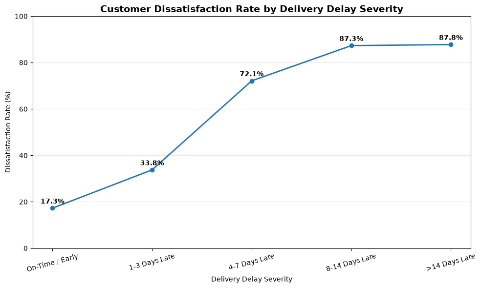
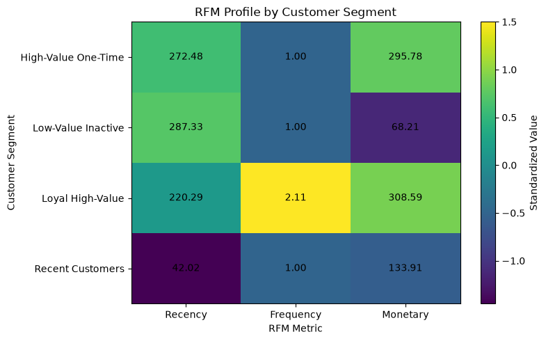
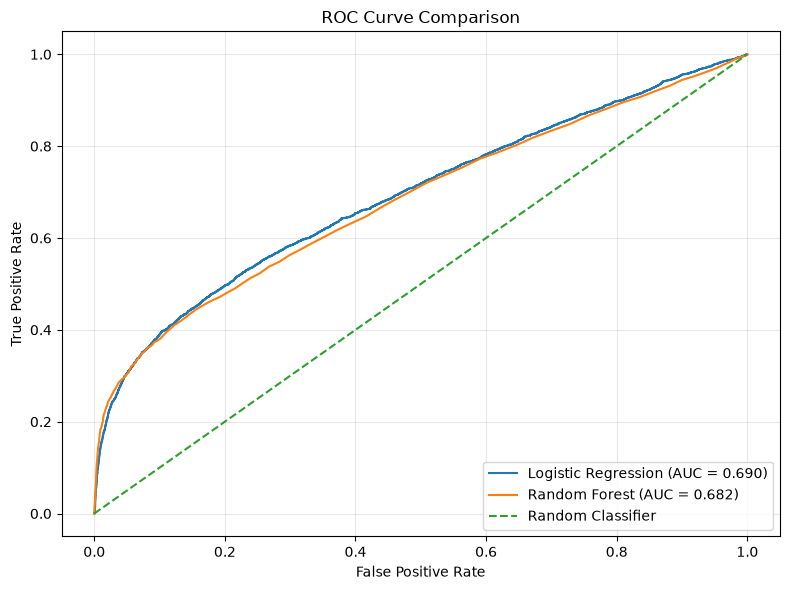
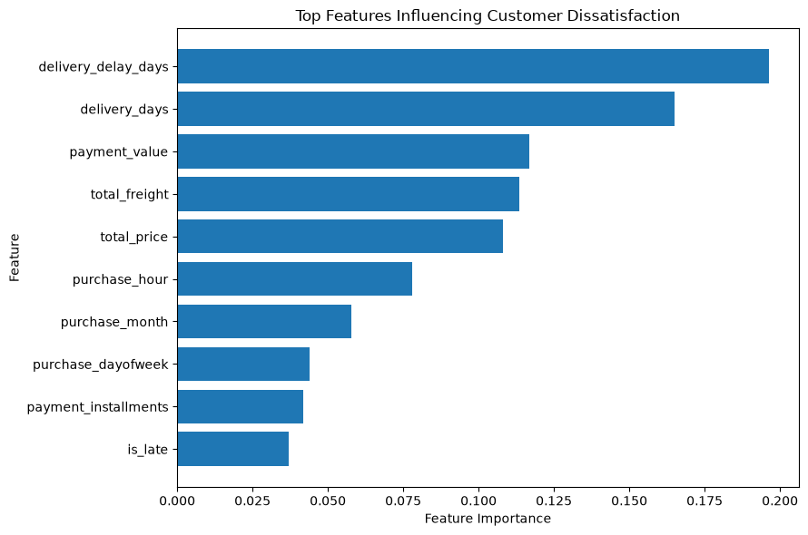

<div align="center">

# OLIST E-COMMERCE
### End-to-End Data Analytics & Machine Learning

**From Raw Data to Business Intelligence & Predictive Insights**


*Dự án phân tích dữ liệu thương mại điện tử Olist (Brazil), kết hợp Data Engineering, Business Intelligence và Machine Learning để chuyển đổi dữ liệu thành những thông tin hỗ trợ ra quyết định.*

</div>

---

## Project Overview

### Bối cảnh dự án

Olist là nền tảng thương mại điện tử tại Brazil, kết nối người bán với khách hàng thông qua các sàn giao dịch trực tuyến.

Dự án sử dụng bộ dữ liệu **Brazilian E-Commerce Public Dataset by Olist**, bao gồm thông tin về đơn hàng, khách hàng, sản phẩm, thanh toán, đánh giá và quá trình giao hàng.

Mục tiêu của dự án là xây dựng một quy trình phân tích dữ liệu hoàn chỉnh, từ dữ liệu thô đến hệ thống báo cáo và các kết quả phân tích nâng cao.

### Project at a Glance

| Category | Description |
|---|---|
| **Domain** | E-Commerce Analytics |
| **Dataset** | Brazilian E-Commerce Public Dataset by Olist |
| **Data Source** | 9 CSV Files |
| **NoSQL Database** | MongoDB Atlas – 5 Collections |
| **Relational Database** | SQL Server – 8 Tables |
| **Analytics** | EDA, Statistical Testing, RFM Segmentation |
| **Machine Learning** | K-Means, Logistic Regression, Random Forest |
| **Visualization** | Power BI, Matplotlib |
| **Reporting** | PowerPoint |

### Project Objectives

- Xây dựng quy trình xử lý dữ liệu từ CSV đến MongoDB và SQL Server.
- Làm sạch, chuyển đổi và kiểm tra chất lượng dữ liệu bằng Python và SQL.
- Phân tích doanh thu, sản phẩm, khách hàng và hiệu quả giao hàng.
- Xây dựng Dashboard tương tác bằng Power BI.
- Phân tích mối liên hệ giữa hiệu quả giao hàng và sự hài lòng của khách hàng.
- Phân khúc khách hàng bằng phương pháp RFM và K-Means.
- Ứng dụng Machine Learning để nghiên cứu khả năng dự đoán khách hàng không hài lòng.

### Business Questions

Dự án tập trung trả lời những câu hỏi kinh doanh sau:

1. Doanh thu và số lượng đơn hàng biến động như thế nào theo thời gian?
2. Những ngành hàng và khu vực nào đóng góp nhiều vào doanh thu?
3. Hiệu quả giao hàng có liên quan đến trải nghiệm khách hàng không?
4. Có thể phân khúc khách hàng dựa trên hành vi mua sắm như thế nào?
5. Machine Learning có thể hỗ trợ dự đoán mức độ không hài lòng của khách hàng hay không?

---

## End-to-End Data Architecture

Dự án triển khai một quy trình xử lý dữ liệu kết hợp NoSQL, cơ sở dữ liệu quan hệ, Business Intelligence và Machine Learning.

<div align="center">



*End-to-End Data Pipeline Architecture*

</div>

### Data Pipeline

| Stage | Technology | Description |
|---|---|---|
| 01. Data Collection | Olist CSV | Thu thập 9 bộ dữ liệu gốc |
| 02. Data Processing | Python, Pandas | Xử lý dữ liệu và chuyển đổi CSV sang JSON |
| 03. NoSQL Storage | MongoDB Atlas | Lưu trữ dữ liệu trong 5 collections |
| 04. ETL Pipeline | Python, PyMongo, SQLAlchemy | Trích xuất, chuyển đổi và nạp dữ liệu |
| 05. Relational Storage | SQL Server | Tổ chức dữ liệu thành 8 bảng |
| 06. Business Intelligence | Power BI | Phân tích KPI và xây dựng Dashboard |
| 07. Advanced Analytics | SciPy, Scikit-learn | Phân tích thống kê và Machine Learning |
| 08. Reporting | PowerPoint | Tổng hợp kết quả và Business Insights |

### MongoDB Collections

Dữ liệu được tổ chức thành 5 collections:

| Collection | Documents |
|---|---:|
| customers | 99,441 |
| geolocation | 19,015 |
| orders | 99,441 |
| products | 32,951 |
| sellers | 3,095 |

Dữ liệu đơn hàng được tổ chức dưới dạng tài liệu JSON, tích hợp thông tin liên quan đến sản phẩm trong đơn, thanh toán và đánh giá.

### SQL Server Tables

Sau quá trình ETL, dữ liệu được tổ chức thành 8 bảng quan hệ:

| Table | Records |
|---|---:|
| customers | 99,441 |
| geolocation | 19,015 |
| orders | 99,441 |
| order_items | 112,650 |
| order_payments | 103,886 |
| order_reviews | 99,224 |
| products | 32,951 |
| sellers | 3,095 |

Quá trình kiểm tra số lượng bản ghi giữa nguồn dữ liệu và SQL Server đã được thực hiện nhằm xác nhận tính nhất quán của dữ liệu sau ETL.

---

## Power BI Dashboards

Power BI được sử dụng để xây dựng hệ thống báo cáo tương tác, giúp theo dõi các chỉ số kinh doanh và phân tích hiệu quả hoạt động thương mại điện tử.

### 01 — Executive Overview

<div align="center">



*Executive Overview Dashboard*

</div>

Dashboard tổng quan cung cấp cái nhìn toàn diện về hiệu quả kinh doanh của Olist.

**Các nội dung phân tích chính:**

- Tổng doanh thu và số lượng đơn hàng.
- Số lượng khách hàng.
- Average Order Value (AOV).
- Xu hướng doanh thu theo thời gian.
- Các chỉ số hiệu quả hoạt động tổng quan.

### 02 — Sales & Product Analysis

<div align="center">



*Sales & Product Analysis Dashboard*

</div>

Dashboard tập trung phân tích hiệu quả kinh doanh theo sản phẩm, ngành hàng và khu vực.

**Các nội dung phân tích chính:**

- Doanh thu theo khu vực địa lý.
- Những ngành hàng đóng góp doanh thu nổi bật.
- Hiệu quả kinh doanh theo danh mục sản phẩm.
- Cơ cấu phương thức thanh toán.
- So sánh các chỉ số bán hàng.

### 03 — Customer & Delivery Analysis

<div align="center">



*Customer & Delivery Analysis Dashboard*

</div>

Dashboard tập trung nghiên cứu hiệu quả giao hàng và trải nghiệm khách hàng.

**Các nội dung phân tích chính:**

- Hiệu quả giao hàng theo khu vực.
- Phân bố trạng thái giao hàng.
- Thời gian giao hàng trung bình.
- Phân bố điểm đánh giá khách hàng.
- Mối liên hệ giữa thời gian giao hàng và điểm đánh giá.

**Power BI Report:** [CAPSTONE_DA_ADV_04_PowerBI.pbix](powerbi/CAPSTONE_DA_ADV_04_PowerBI.pbix)

---

## Advanced Analytics & Machine Learning

Bên cạnh việc xây dựng Dashboard, dự án sử dụng Python để khám phá dữ liệu, kiểm định thống kê và phát triển các mô hình Machine Learning.

### 01 — Delivery Performance & Customer Satisfaction

Phân tích tập trung nghiên cứu mối liên hệ giữa mức độ trễ giao hàng và tỷ lệ khách hàng không hài lòng.

<div align="center">



*Customer Dissatisfaction Rate by Delivery Delay Severity*

</div>

#### Key Findings

| Delivery Status | Dissatisfaction Rate |
|---|---:|
| On-Time / Early | 17.3% |
| 1–3 Days Late | 33.8% |
| 4–7 Days Late | 72.1% |
| 8–14 Days Late | 87.3% |
| More than 14 Days Late | 87.8% |

**Insight**

Tỷ lệ khách hàng không hài lòng tăng đáng kể khi thời gian giao hàng vượt quá ngày dự kiến.

Đặc biệt, nhóm đơn hàng trễ trên 14 ngày có tỷ lệ không hài lòng lên đến 87.8%, cao hơn nhiều so với nhóm giao đúng hạn hoặc sớm.

**Business Implication**

Doanh nghiệp nên ưu tiên cải thiện hiệu quả giao hàng, theo dõi các đơn hàng có nguy cơ trễ và chủ động thông báo cho khách hàng khi phát sinh vấn đề vận chuyển.

### 02 — Customer Segmentation with RFM & K-Means

Dự án sử dụng phương pháp RFM kết hợp K-Means để phân tích hành vi mua sắm và phân khúc khách hàng.

RFM bao gồm:

- **Recency:** Khoảng thời gian kể từ lần mua hàng gần nhất.
- **Frequency:** Tần suất mua hàng của khách hàng.
- **Monetary:** Tổng giá trị chi tiêu.

<div align="center">



*Customer Segmentation Based on RFM Characteristics*

</div>

#### Customer Segments

Các phân khúc được xác định trong quá trình phân tích bao gồm:

| Segment | Characteristics |
|---|---|
| High-Value One-Time | Khách hàng có giá trị chi tiêu cao nhưng ít giao dịch |
| Low-Value Inactive | Khách hàng ít hoạt động và có giá trị chi tiêu thấp |
| Loyal High-Value | Khách hàng có mức độ gắn bó và giá trị cao |
| Recent Customers | Khách hàng có giao dịch gần thời điểm phân tích |

**Business Implication**

Kết quả phân khúc có thể hỗ trợ doanh nghiệp xây dựng các chiến lược marketing phù hợp, phát triển chương trình chăm sóc khách hàng và nâng cao hiệu quả giữ chân khách hàng.

### 03 — Predicting Customer Dissatisfaction

Dự án ứng dụng các mô hình Machine Learning để nghiên cứu khả năng dự đoán khách hàng không hài lòng dựa trên các đặc trưng liên quan đến đơn hàng và quá trình giao hàng.

**Machine Learning Models:**

- Logistic Regression
- Random Forest

#### Model Performance

<div align="center">



*ROC Curve Comparison — Logistic Regression vs Random Forest*

</div>

| Model | ROC-AUC |
|---|---:|
| Logistic Regression | 0.690 |
| Random Forest | 0.682 |

Logistic Regression đạt ROC-AUC nhỉnh hơn Random Forest trong kết quả đánh giá.

Tuy nhiên, khả năng phân biệt giữa các nhóm khách hàng vẫn ở mức trung bình. Kết quả phù hợp cho mục đích nghiên cứu và thử nghiệm, nhưng cần tiếp tục cải thiện trước khi triển khai thực tế.

#### Feature Importance

<div align="center">



*Feature Importance Analysis*

</div>

Một số đặc trưng nổi bật trong phân tích gồm:

- Delivery Delay Days
- Delivery Days
- Payment Value
- Total Freight
- Total Price

**Business Implication**

Việc phân tích đặc trưng giúp xác định các yếu tố có giá trị dự đoán đối với mức độ không hài lòng, từ đó hỗ trợ doanh nghiệp lựa chọn các chỉ số cần theo dõi và nghiên cứu sâu hơn.

---

## Key Business Insights

Dựa trên kết quả từ Power BI và Python Analytics, dự án tổng hợp những phát hiện chính sau:

| Key Finding | Business Implication |
|---|---|
| Giao hàng trễ có liên quan đến tỷ lệ không hài lòng cao hơn | Ưu tiên cải thiện hiệu quả vận chuyển và quản lý đơn hàng trễ |
| Các nhóm khách hàng có hành vi RFM khác nhau | Phát triển chiến lược marketing và chăm sóc theo phân khúc |
| Mô hình ML có khả năng phân biệt khách hàng không hài lòng ở mức nhất định | Tiếp tục cải thiện dữ liệu, đặc trưng và mô hình |
| Dashboard tổng hợp các chỉ số doanh thu, sản phẩm và giao hàng | Hỗ trợ theo dõi hiệu quả kinh doanh và vận hành |

### Overall Conclusion

Dự án cho thấy giá trị của việc kết hợp Data Engineering, Business Intelligence và Machine Learning trong một quy trình phân tích dữ liệu thương mại điện tử.

Không chỉ trực quan hóa các chỉ số kinh doanh, quá trình phân tích còn giúp khám phá những vấn đề liên quan đến trải nghiệm khách hàng, hiệu quả giao hàng và sự khác biệt giữa các nhóm khách hàng.

---

## Repository Structure

```text
olist-ecommerce-end-to-end-analytics/
│
├── assets/
│   ├── architecture/
│   │   └── data-pipeline.png
│   │
│   ├── analytics/
│   │   ├── delivery-delay-impact.png
│   │   ├── customer-segmentation-rfm.png
│   │   ├── ml-roc-comparison.png
│   │   └── ml-feature-importance.png
│   │
│   └── dashboard/
│       ├── dashboard-overview.png
│       ├── dashboard-sales-products.png
│       └── dashboard-customer-delivery.png
│
├── data/
│   ├── raw/
│   └── json/
│
├── notebooks/
│   ├── CSV_to_JSON_MongoDB.ipynb
│   ├── MongoDB_to_SQLServer_ETL.ipynb
│   └── Olist_data_analytics.ipynb
│
├── sql/
│   ├── 01_Database_Setup_Validation.sql
│   └── 02_Data_Analysis_Queries.sql
│
├── powerbi/
│   └── CAPSTONE_DA_ADV_04_PowerBI.pbix
│
├── reports/
│   └── CAPSTONE_DA_ADV_04_PowerPoint.pptx
│
├── .env.example
├── .gitignore
├── requirements.txt
└── README.md
```

**Note:** Các tệp dữ liệu thô, JSON được tạo ra và thông tin kết nối thực tế không được đưa lên GitHub nhằm hạn chế dung lượng và bảo vệ cấu hình hệ thống.

---

## Installation & Reproducibility

### 1. Clone Repository

```bash
git clone https://github.com/<username>/olist-ecommerce-end-to-end-analytics.git
cd olist-ecommerce-end-to-end-analytics
```

Thay `<username>` bằng tên tài khoản GitHub tương ứng sau khi repository được xuất bản.

### 2. Create Virtual Environment

```bash
python -m venv .venv
```

Kích hoạt môi trường trên Windows PowerShell:

```powershell
.\.venv\Scripts\Activate.ps1
```

### 3. Install Dependencies

```bash
python -m pip install -r requirements.txt
```

### 4. Configure Environment Variables

Sao chép `.env.example` thành `.env` và cập nhật thông tin kết nối MongoDB Atlas, SQL Server.

Không đưa mật khẩu, connection string có chứa thông tin xác thực hoặc các tệp chứa thông tin nhạy cảm lên GitHub.

### 5. Prepare Dataset

Tải bộ dữ liệu tại:

[Olist Brazilian E-Commerce Dataset — Kaggle](https://www.kaggle.com/datasets/olistbr/brazilian-ecommerce)

Đặt 9 tệp CSV vào thư mục:

```text
data/raw/
```

### 6. Execute Notebooks

Thực hiện theo thứ tự:

1. `notebooks/CSV_to_JSON_MongoDB.ipynb`
2. `notebooks/MongoDB_to_SQLServer_ETL.ipynb`
3. `notebooks/Olist_data_analytics.ipynb`

Các notebook thực hiện những nhiệm vụ khác nhau trong quy trình xử lý và phân tích dữ liệu.

**Lưu ý:** Việc tái lập toàn bộ pipeline yêu cầu cấu hình MongoDB Atlas, SQL Server, ODBC Driver và đường dẫn dữ liệu phù hợp. Power BI cũng cần được cấu hình lại kết nối đến nguồn SQL Server trên máy sử dụng.

---


## Project Deliverables

| Deliverable | Description |
|---|---|
| [Python Notebooks](notebooks/) | Data Processing, ETL, Analytics & Machine Learning |
| [SQL Scripts](sql/) | Database Validation & Analytical Queries |
| [Power BI Report](powerbi/CAPSTONE_DA_ADV_04_PowerBI.pbix) | Interactive Business Dashboards |
| [PowerPoint Report](reports/CAPSTONE_DA_ADV_04_PowerPoint.pptx) | Tổng hợp quá trình và kết quả phân tích |
| [Technical Documentation](docs/) | Tài liệu kỹ thuật và minh chứng xây dựng cơ sở dữ liệu MongoDB |


---

## Dataset & Acknowledgement

**Dataset:** Brazilian E-Commerce Public Dataset by Olist

**Source:** [Kaggle – Olist Brazilian E-Commerce](https://www.kaggle.com/datasets/olistbr/brazilian-ecommerce)

Dự án được thực hiện với mục đích học tập, thực hành và xây dựng Data Analytics Portfolio.

---

<div align="center">

### From Data to Decisions

*Transforming raw e-commerce data into actionable business insights.*

**Python · MongoDB · SQL Server · Power BI · Machine Learning**

</div>
